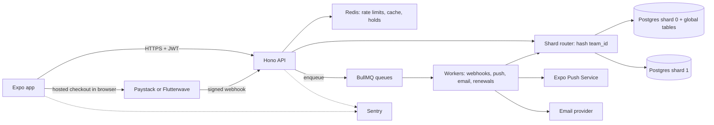

# Rota PRD

| Field | Value |
|---|---|
| Product | Rota, a shift scheduling app for small teams |
| Version | 1.0 (draft) |
| Date | 12 October 2026 |
| Owner | Kate Ahurika |
| Context | Graduation task, Part 2, Task A (Dev and Design HQ) |
| Deadline | Monday, 19 October 2026 |
| Status | Ready for build |

---

## 1. Summary

Rota helps small teams such as restaurants, clinics, and retail stores plan who works when. An owner creates a team, invites staff, and publishes shifts. Staff see their shifts, request swaps with other staff, and get push notifications when anything changes. Managers approve swaps. The business pays a monthly subscription priced per seat.

### 1.1 Why this project exists

This is a hiring-portfolio project. It must prove to a remote employer that the builder can handle:

1. Authentication with token rotation and invite links
2. Money: proration, a ledger, webhooks, idempotency
3. Push notifications that respect user settings
4. Data that stays correct under load (cursor pagination, caching, sharding, pooling)

### 1.2 Success criteria

Rota is done when all of these are true:

- Every required feature in section 5 works on a real Android development build against the deployed backend.
- Every proof test in section 11 passes and its output is saved in `docs/test-results/`.
- All deliverables in section 13 exist and are linked from `SUBMISSION.md`.
- The builder can explain every line of code and answer every interview question in section 15.

### 1.3 Goals and non-goals

**Goals**
- Correct permissions and tenant isolation, enforced on the server
- Correct money, rebuildable from an append-only ledger
- A polished, accessible, fast mobile experience for a shift feed and calendar
- Evidence for every claim (query plans, load test numbers, test output)

**Non-goals**
- Publishing to the App Store or Play Store
- iOS builds (Android development build is enough)
- Payroll, time clocks, or hour tracking
- Web admin dashboard
- Multi-language content beyond storing a language setting

---

## 2. Users and roles

| Role | Who | Goal |
|---|---|---|
| Owner | Business owner | Create the team, manage billing, control everything |
| Manager | Shift lead or supervisor | Create and edit shifts, approve swaps |
| Staff | Waiter, nurse, cashier | See their shifts, request swaps, set preferences |

### 2.1 Permission matrix (server-enforced)

| Action | Owner | Manager | Staff |
|---|---|---|---|
| Create team | Yes (any signed-in user becomes owner of a new team) | n/a | n/a |
| Invite members | Yes | Yes (staff only) | No |
| Remove members | Yes | Staff only | No |
| Change member roles | Yes | No | No |
| View billing and plans | Yes | No | No |
| Change plan or seats | Yes | No | No |
| Create, edit, delete shifts | Yes | Yes | No |
| Assign shifts | Yes | Yes | No |
| View team shifts and roster | Yes | Yes | Yes |
| Request a swap for own shift | Yes | Yes | Yes |
| Approve or reject swaps | Yes | Yes | No (and never their own swap) |
| View activity feed | Yes | Yes | Yes |
| Edit own settings | Yes | Yes | Yes |
| Log out of all devices (own account) | Yes | Yes | Yes |

Every row is enforced by server middleware plus a test. The mobile app only hides buttons.

---

## 3. Scope

### 3.1 In scope

Sign up, log in, log out, magic link login, invite by email or link, roles, shift calendar, shift swaps with approval, paginated activity feed, subscription plans with seat pricing and proration, push notifications, synced settings, offline viewing of upcoming shifts, and the backend design standard (pooling, replica routing, sharding simulation, caching, rate limiting, queues, idempotency, observability, load test).

### 3.2 Out of scope

Payroll, time tracking, chat, availability polling, shift templates, recurring shifts, web app, iOS build, store publishing, tax invoices.

---

## 4. Assumptions and open questions

Every assumption below is a decision made so the build is not blocked. Record each as an ADR in `docs/decisions/`. Change them in one config file if a facilitator says otherwise.

| ID | Assumption | Why |
|---|---|---|
| A1 | Second sign-in method is **magic link** (not Google) | Reuses the deep link work needed for invites. No Google console setup |
| A2 | Seat caps: Starter 5, Team 30, Business 100. Seats above "included" cost the extra seat price | The brief gives included seats and extra seat prices but no hard caps |
| A3 | A "seat" is an active member (any role) plus pending invites | Makes "Starter cannot invite a sixth person" enforceable at invite time |
| A4 | Billing period length is stored per subscription in days (default 30). Remaining days = period days minus whole elapsed days | Matches the brief's example (change on the 11th gives 20 days left) |
| A5 | A change that raises the monthly price takes effect now and is charged with proration. A change that lowers it takes effect at period end, with no refund | Matches the brief |
| A6 | Grace period for a failed renewal is 7 days. Owner is notified on day 0, 3, and 6. After day 7 the team is in restricted mode | The brief asks for "a set number of days" |
| A7 | Restricted mode: members can view shifts; creating or editing shifts, inviting, and approving swaps are blocked. Owner can still open billing and pay | Keeps the team able to see schedules while pressuring payment |
| A8 | Access token lifetime 15 minutes. Refresh token lifetime 30 days, rotated on every use | Short window for theft; usable sessions |
| A9 | Urgent notification = a change to a shift starting within the next 2 hours. Urgent ones ignore quiet hours. Everything else waits | The brief says "delays non-urgent notifications" without defining urgent |
| A10 | Settings conflict rule: server time `updatedAt` per field, last write to arrive wins | Matches the brief. Weakness documented in section 7 |
| A11 | Currency on the ledger is USD cents because the brief prices plans in dollars | See open question OQ1 |

| ID | Open question | Default if unanswered |
|---|---|---|
| OQ1 | Does the chosen provider (Paystack or Flutterwave) accept USD test charges on this account? | Pick the provider that does. If neither does, keep the ledger in USD cents and charge the provider in NGN using a fixed rate stored in config. Record the rate on every ledger row and write an ADR |
| OQ2 | Can the provider charge a saved card for renewals in test mode? | If not, the renewal job creates a hosted checkout link and notifies the owner. Webhook handling stays identical |
| OQ3 | Does the free Redis tier handle BullMQ polling volume? | Check the host's current command limits. If too tight, use a Redis from the backend host |

---

## 5. Functional requirements

Each requirement has an ID, a plain description, and acceptance criteria (AC). A requirement is not done until every AC is demonstrated.

### 5.1 Authentication and invites

| ID | Requirement | Acceptance criteria |
|---|---|---|
| FR-A1 | Sign up and log in with email and password | Password hashed with argon2id. Weak passwords rejected by Zod. Generic error on wrong login (no account enumeration) |
| FR-A2 | Magic link login | Link token is single-use, expires in 15 minutes, stored hashed. Opens the app via deep link |
| FR-A3 | Short-lived access token plus rotating refresh token | Access token 15 min. Each refresh returns a new refresh token and marks the old one used |
| FR-A4 | Refresh token reuse detection | Replaying a used refresh token returns 401 and revokes the whole token family |
| FR-A5 | Tokens stored in `expo-secure-store` | No tokens in AsyncStorage. Shown in code review and in `SECURITY.md` |
| FR-A6 | Log out | Revokes the current refresh token family and deletes this device's push token |
| FR-A7 | Log out of all devices | Revokes all refresh tokens, bumps token version, deletes all push tokens. Old access tokens stop working within the documented window |
| FR-A8 | Password reset | Single-use token, expires in 30 minutes, stored hashed. Reset revokes all sessions. Request endpoint always answers the same message |
| FR-A9 | Invite flow | Owner or manager creates an invite (email or link). Staff opens `rota://invite/<token>`, signs up or logs in, and lands inside the right team with the invited role |
| FR-A10 | Invite rules | Invite token single-use, expires in 7 days, counts toward the seat limit while pending |

### 5.2 Teams, roles, and tenant isolation

| ID | Requirement | AC |
|---|---|---|
| FR-T1 | Create a team | Creator becomes Owner. Team gets a free Starter subscription state of "trialing" until first payment (decision recorded in ADR) |
| FR-T2 | Membership with roles | One user may belong to several teams. Role is per team |
| FR-T3 | Server-side permission checks | A Staff token calling `DELETE /teams/:id/shifts/:shiftId` gets 403. Test proves it |
| FR-T4 | Team isolation | A user from team A requesting team B data gets 404 (not 403, to avoid leaking existence). Test proves it |
| FR-T5 | Seat limits | Invite or accept beyond the seat limit returns 409 with a clear code. Test proves a Starter team cannot add a sixth member |

### 5.3 Shifts, calendar, and swaps

| ID | Requirement | AC |
|---|---|---|
| FR-S1 | Create, edit, delete shifts | Fields: start, end, role label, location note, assignee. End after start. No overlapping shifts for the same assignee |
| FR-S2 | Shift calendar | Day and week views. Range query by date. Cached per team with invalidation |
| FR-S3 | Request a swap | Staff picks one of their own shifts and optionally a target colleague. Optimistic update in the app with rollback |
| FR-S4 | Approve or reject a swap | Manager or Owner decides. Requester cannot approve. Approval moves the assignment inside one transaction |
| FR-S5 | Swap states | `pending`, `approved`, `rejected`, `cancelled`, `expired`. Only valid transitions allowed |
| FR-S6 | No double submit | Duplicate swap requests for the same shift return the existing request |

### 5.4 Activity feed

| ID | Requirement | AC |
|---|---|---|
| FR-F1 | Feed of new shifts, swaps, changes | One event row per change, written in the same transaction as the change |
| FR-F2 | Cursor pagination | Cursor = timestamp plus id. No skipped or repeated items when new items arrive. Test inserts items between page loads |
| FR-F3 | Index and query plan | `EXPLAIN ANALYZE` before and after the index saved in `docs/performance/` |
| FR-F4 | 10,000 seeded records | Seed script included and documented |
| FR-F5 | App behaviour | FlashList infinite scroll, pull to refresh, loading, empty, end-of-list, error states, no duplicate requests on fast scroll |

### 5.5 Subscriptions and billing

Details in section 6.

| ID | Requirement | AC |
|---|---|---|
| FR-B1 | Plans with exact prices in cents | Starter 2000, Team 5000, Business 12000. Extra seats 300 and 200 |
| FR-B2 | Proration on the server | Pure function, no provider calculation. At least 8 unit tests (target 14) |
| FR-B3 | Provider checkout in test mode | App opens hosted checkout. App never decides success |
| FR-B4 | Verified webhooks | Signature checked on the raw body. Event id stored. Duplicate ignored. Work done in a background job |
| FR-B5 | Idempotency keys | Every payment initiation requires `Idempotency-Key`. Same key returns the stored result |
| FR-B6 | Append-only ledger | Charges, credits, refunds are rows. No update or delete (enforced by database trigger). Subscription state can be rebuilt from the ledger |
| FR-B7 | Seat limits enforced | See FR-T5 |
| FR-B8 | Failed renewal | Grace period, owner notifications, then restricted mode (A6, A7) |
| FR-B9 | Scheduled downgrades | Stored as a pending change and applied by the renewal job |

### 5.6 Push notifications

| ID | Requirement | AC |
|---|---|---|
| FR-N1 | Register device token after login | Stored per user and device. Several devices per user supported |
| FR-N2 | Sent from a background job only | The request that triggers a notification only enqueues work |
| FR-N3 | Invalid tokens removed | Expo receipt `DeviceNotRegistered` deletes the token |
| FR-N4 | Deep link on tap | Opens the exact shift, swap, or billing screen. Unknown routes are ignored |
| FR-N5 | Type toggles | `shift_changes`, `swaps`, `billing` can be turned on or off per user |
| FR-N6 | Quiet hours and time zone | Checked in the worker using the user's saved time zone. Non-urgent notifications are delayed to the end of quiet hours |
| FR-N7 | Retries | Exponential backoff, 5 attempts, then moved to the failed list and logged |

### 5.7 Settings

| ID | Requirement | AC |
|---|---|---|
| FR-ST1 | Server is the single source of truth | Settings: quiet hours, time zone, notification types, language, theme |
| FR-ST2 | Cross-device sync | App refetches on launch and when it returns to the foreground |
| FR-ST3 | Conflict rule | Server-set `updatedAt` per field. Most recent write wins. Documented with its weakness |
| FR-ST4 | Optimistic updates with rollback | Settings changes show instantly and revert on failure |
| FR-ST5 | Server obeys settings | Worker test proves quiet hours delay a 2am notification until 6am local time |

### 5.8 Offline

| ID | Requirement | AC |
|---|---|---|
| FR-O1 | Upcoming shifts visible offline | Persisted query cache. Airplane mode demo in the video |
| FR-O2 | "Last updated" label | Visible on the shifts screen. Shows an offline banner when offline |

---

## 6. Billing specification

### 6.1 Plans (all money in integer cents)

| Plan | Monthly price | Seats included | Extra seat per month | Seat cap (A2) |
|---|---|---|---|---|
| Starter | 2000 | up to 5 | not available | 5 |
| Team | 5000 | up to 15 | 300 | 30 |
| Business | 12000 | up to 40 | 200 | 100 |

**Monthly price formula**

```
monthly(plan, seats) = basePrice(plan) + max(0, seats - includedSeats(plan)) * extraSeatPrice(plan)
```

Starter has no extra seats, so `seats` must be 1 to 5.

### 6.2 Proration formula

```
elapsedDays   = floor((changeTime - periodStart) / 1 day)
remainingDays = periodDays - elapsedDays          (minimum 1, maximum periodDays)

oldPart = floor(oldMonthly * remainingDays / periodDays)    // credit for unused time
newPart = floor(newMonthly * remainingDays / periodDays)    // cost for remaining time
chargeToday = newPart - oldPart                              // only when newMonthly >= oldMonthly (equal price gives 0)
```

**Rounding rule:** round down (floor) each part separately, then subtract. All math uses integers.

**Direction rule (A5):** If `newMonthly > oldMonthly`, the change applies immediately and `chargeToday` is charged. If `newMonthly == oldMonthly` (for example adding seats that are still inside the included count), the change applies immediately and the charge is 0. If `newMonthly < oldMonthly`, the change is saved as a pending change that applies at the next renewal. No credit or refund is issued.

**Worked examples**

| Case | Calculation | Result |
|---|---|---|
| Starter to Team on the 11th of a 30-day period | elapsed 10, remaining 20. old floor(2000*20/30)=1333. new floor(5000*20/30)=3333 | Charge 2000 |
| Team customer at 15 seats adds 3 seats, 12 days left | old 5000, new 5900. old floor(5000*12/30)=2000. new floor(5900*12/30)=2360 | Charge 360 |
| Team to Starter | newMonthly 2000 is below 5000 | Scheduled for period end, charge 0 |
| Team at 10 seats adds 4 (to 14) | monthly stays 5000 | Charge 0, applies now |

### 6.3 Rules

1. Two changes in one period: the second change compares against the current effective monthly price (which includes the first change if it was immediate).
2. A new immediate change cancels any pending scheduled change.
3. Seat count can never drop below active members plus pending invites.
4. Renewal uses the pending change if one exists, otherwise the current plan and seats. Full price is charged on renewal.
5. Every charge, credit, and refund is a new ledger row with an idempotency key. Rows are never edited.

### 6.4 Failed renewal (A6, A7)

```
Day 0: renewal fails -> status past_due, notify owner, grace_ends_at = now + 7 days
Day 3, Day 6: reminder notifications
Day 7: if still unpaid -> status restricted
Payment succeeds at any point -> ledger charge row, status active, restrictions lifted
```

### 6.5 App store billing note (for the README)

Apple and Google require their own in-app purchase systems for many digital subscriptions sold inside apps. Rota sells a business software subscription. In production, the team must check the current Apple guidelines on enterprise and business services (section 3.1.3) and the current Google Play payments policy to decide whether checkout can stay outside the app, or whether billing must move to the website. Write your conclusion in the README with links to the current policy text and state any uncertainty.

---

## 7. Non-functional requirements

| Area | Requirement |
|---|---|
| Security | Server enforces all permissions. Zod validates every body, query, and param. No secrets in the bundle. Rate limits on login, reset, invites, payment, and magic link. `SECURITY.md` lists 8 threats |
| Performance targets | Activity feed first page p95 under 200 ms cached and under 600 ms uncached at 200 virtual users. Calendar range query p95 under 300 ms. Cursor query uses an index scan |
| Reliability | Webhooks and notifications retry with exponential backoff. Jobs fail into a failed list after 5 attempts |
| Consistency | Money: strongly consistent (primary database, no cache). Feed and calendar: eventually consistent within the cache TTL |
| Observability | Every request logged with request id, user id, route, duration, status. Every job attempt logged. Sentry on app and server |
| Accessibility | 4.5 to 1 contrast, labels on controls, 44 point touch targets, scalable text |
| Offline | Upcoming shifts readable with no network |
| Settings weakness (A10) | Last write to arrive wins, not last edit made. A change made offline earlier can overwrite a newer change made online on another device. The alternative is client timestamps with clock skew risk or version vectors |

---

## 8. System design summary

### 8.1 Stack

| Layer | Choice |
|---|---|
| Mobile | React Native, Expo (development build via EAS Build), Expo Router, TypeScript |
| Server state | TanStack Query, with the persist plugin for offline |
| Client state | Zustand (small, no boilerplate, fits UI-only state) |
| Lists | FlashList |
| Backend | Node.js with Hono (TypeScript) |
| Validation | Zod |
| Database | PostgreSQL (two databases for the sharding simulation), accessed through Prisma with raw SQL where precision matters |
| Cache, locks, rate limits | Redis (Upstash or host Redis) |
| Queue | BullMQ |
| Payments | Paystack or Flutterwave in test mode |
| Email | Resend (magic link, invites, reset), sent from jobs |
| Push | Expo Push Service via `expo-server-sdk` |
| Errors | Sentry (app and server) |
| Load tests | k6 |
| Tests | Vitest |
| Deploy | Render, Railway, or Fly (record the choice in an ADR) |

### 8.2 Architecture diagram



### 8.3 Data placement (sharding simulation)

- **Shard key:** `team_id`. Shard index = first 4 bytes of `sha256(team_id)` as an unsigned integer, modulo 2.
- **Sharded tables (team data):** teams, memberships, invites, shifts, swap_requests, activity_events, subscriptions, ledger_entries, payment_attempts, webhook_events.
- **Global tables (live in database 0):** users, refresh_tokens, magic_links, password_resets, devices, user_settings, team_directory (user to team, role, shard).
- **Known weakness:** database 0 holds both global tables and its share of team data, so it takes more load. This is documented in `SHARDING.md`.
- **Hard queries:** "all teams for a user" (solved by `team_directory`), "all past-due subscriptions" (scatter-gather across both shards), cross-team reports.
- **Very large team:** move to a dedicated shard and record the mapping in a `team_shard_overrides` table checked before the hash.

### 8.4 Connection pooling and read routing

- Use the provider's pooled connection string where available. Server pool max 10 per shard for the API process. Workers have their own smaller pool (max 5). Document the maths: provider connection limit divided by processes, with headroom for migrations.
- Read routing: `db.forRead(teamId, userId)` returns the replica connection unless Redis key `recent_write:{userId}` exists (set for 5 seconds after any write). If Redis is unavailable, read from the primary. Without a real replica, the read string can point at the same database in development. Document what changes in production.

---

## 9. API surface (v1)

All routes are under `/v1`. All bodies validated with Zod. Errors use one shape: `{ "error": { "code": "STRING", "message": "text", "requestId": "uuid" } }`.

| Method | Path | Role | Notes |
|---|---|---|---|
| POST | /auth/register | public | rate limited |
| POST | /auth/login | public | rate limited |
| POST | /auth/magic-link | public | rate limited, generic response |
| POST | /auth/magic-link/verify | public | single-use token |
| POST | /auth/refresh | public | rotation and reuse detection |
| POST | /auth/logout | user | current session |
| POST | /auth/logout-all | user | all sessions and devices |
| POST | /auth/password-reset/request | public | rate limited, generic response |
| POST | /auth/password-reset/confirm | public | single-use token |
| POST | /teams | user | creator becomes owner |
| GET | /teams | user | via team_directory |
| GET | /teams/:teamId/members | member | cached roster |
| POST | /teams/:teamId/invites | owner, manager | seat check, rate limited |
| POST | /invites/accept | user | token in body |
| PATCH | /teams/:teamId/members/:userId | owner | role change |
| DELETE | /teams/:teamId/members/:userId | owner, manager (staff only) | frees a seat |
| GET | /teams/:teamId/shifts?from=&to= | member | cached calendar |
| POST | /teams/:teamId/shifts | owner, manager | |
| PATCH | /teams/:teamId/shifts/:shiftId | owner, manager | |
| DELETE | /teams/:teamId/shifts/:shiftId | owner, manager | |
| POST | /teams/:teamId/swaps | member | idempotent per shift |
| POST | /teams/:teamId/swaps/:swapId/decision | owner, manager | approve or reject |
| GET | /teams/:teamId/activity?cursor=&limit= | member | cursor pagination |
| GET | /teams/:teamId/billing | owner | never cached |
| POST | /teams/:teamId/billing/preview | owner | returns proration, no side effects |
| POST | /teams/:teamId/billing/change | owner | needs Idempotency-Key |
| POST | /teams/:teamId/billing/checkout | owner | needs Idempotency-Key |
| POST | /webhooks/:provider | provider | raw body, signature check |
| POST | /devices | user | register push token |
| DELETE | /devices/:deviceId | user | |
| GET | /settings | user | |
| PATCH | /settings | user | per-field updatedAt |
| GET | /health | public | liveness |

---

## 10. Data model (key columns and indexes)

| Table | Key columns | Indexes and constraints |
|---|---|---|
| users | id, email (citext), password_hash, token_version, created_at | unique(email) |
| refresh_tokens | id, user_id, family_id, device_id, token_hash, expires_at, used_at, revoked_at | unique(token_hash), index(user_id), index(family_id) |
| magic_links, password_resets | id, user_id or email, token_hash, expires_at, used_at | unique(token_hash) |
| teams | id, name, owner_id, created_at | |
| memberships | team_id, user_id, role, status, created_at | primary key(team_id, user_id) |
| team_directory (global) | user_id, team_id, role, shard | primary key(user_id, team_id) |
| invites | id, team_id, email, role, token_hash, status, expires_at | unique(token_hash), index(team_id, status) |
| shifts | id, team_id, assignee_id, starts_at, ends_at, label, note, updated_at | index(team_id, starts_at), index(team_id, assignee_id, starts_at) |
| swap_requests | id, team_id, shift_id, requester_id, target_id, status, decided_by, decided_at | unique partial index on (shift_id) where status = 'pending' |
| activity_events | id (bigint identity), team_id, type, actor_id, entity_id, payload, created_at (timestamptz(3)) | index(team_id, created_at DESC, id DESC) added after the "before" plan is captured |
| subscriptions | team_id, plan, seats, period_start, period_days, status, grace_ends_at, pending_plan, pending_seats | primary key(team_id) |
| payment_attempts | id, team_id, kind, amount_cents, currency, idempotency_key, provider_ref, status | unique(idempotency_key), unique(provider_ref) |
| webhook_events | id, provider, event_id, payload, status, received_at | unique(provider, event_id) |
| ledger_entries | id, team_id, type (charge, credit, refund, adjustment), amount_cents, currency, plan, seats, reason, idempotency_key, provider_ref, created_at | unique(idempotency_key), trigger blocks UPDATE and DELETE |
| idempotency_keys | user_id, key, request_hash, status, response, created_at | primary key(user_id, key) |
| devices (global) | id, user_id, expo_push_token, platform, last_seen_at | unique(expo_push_token), index(user_id) |
| user_settings (global) | user_id, quiet_start, quiet_end, timezone, notif_types, language, theme, plus `updated_at` per field | primary key(user_id) |

---

## 11. Proof tests (required)

Save runnable output in `docs/test-results/`.

| ID | Test | Proves |
|---|---|---|
| T1 | Staff calls delete shift directly and gets 403 | Server-side permissions |
| T2 | User from team A reads team B shifts and gets 404 | Team isolation |
| T3 | Proration unit tests, 14 cases (list in `proration-engine` skill) | Money math |
| T4 | Refresh token reuse revokes the family | Token theft detection |
| T5 | Same webhook event sent 3 times creates one ledger row | Idempotent webhooks |
| T6 | Bad webhook signature gets 401 and creates nothing | Signature verification |
| T7 | Same Idempotency-Key twice returns the same stored response and one ledger row | Idempotent payments |
| T8 | Starter team cannot invite a sixth member | Seat limits |
| T9 | Cursor pagination with inserts between pages: no skips, no repeats, identical timestamps handled | Feed correctness |
| T10 | Quiet hours worker test: 02:00 local with 22:00 to 06:00 delays to 06:00 local | Settings obeyed |
| T11 | Ledger UPDATE and DELETE fail | Append-only ledger |
| T12 | Rebuilding subscription state from the ledger matches the stored state | Ledger integrity |
| T13 | Rate limit returns 429 after the limit and resets after the window | Redis rate limiting |
| T14 | Invalid push token receipt deletes the device | Token cleanup |

---

## 12. Delivery plan

Build a thin slice first, then deepen. Time boxes assume focused work with an AI agent. If the total exceeds the days left, tell the facilitators early and cut depth (not proof tests).

| Milestone | Scope | Exit criteria | Time box |
|---|---|---|---|
| M0 Setup | Monorepo, Docker Postgres x2 and Redis, env files, CI-less scripts, `.agents` folder in place | `npm run dev` starts server and app. `/health` works | 2 h |
| M1 Auth and DB | Schema, migrations, shard router, register, login, refresh rotation, secure store | T4 passes. App logs in on a device | 6 h |
| M2 Teams and roles | Teams, memberships, invites with deep link, permission middleware | T1, T2, T8 pass | 5 h |
| M3 Shifts, swaps, feed | Shift CRUD, swaps, activity events, cursor pagination, index, 10k seed | T9 passes. Plans saved | 5 h |
| M4 App core | Calendar, feed with FlashList, swap request with optimistic update, offline cache | Airplane mode demo works | 8 h |
| M5 Billing | Plans, proration, checkout, webhook job, ledger, failed renewal | T3, T5, T6, T7, T11, T12 pass | 8 h |
| M6 Notifications and settings | Device tokens, push job, receipts, deep link taps, settings sync, quiet hours | T10, T14 pass. Push on a real device | 6 h |
| M7 Hardening | Redis cache, rate limits, Sentry, logs, k6 load test before and after caching | T13 passes. Report written | 5 h |
| M8 Ship | Deploy backend, EAS Android build, docs, diagram, demo video, LinkedIn post | All section 13 items linked | 6 h |

**If time runs short, cut in this order (never cut proof tests):** polish animations, language setting UI, magic link (keep password login plus one more method only if required by the brief), swap expiry job.

---

## 13. Deliverables checklist

- [ ] Public GitHub repo (monorepo `rota` with `/app`, `/server`, `/docs`, `/load-tests`)
- [ ] Android development build download link (EAS)
- [ ] Deployed backend URL
- [ ] README (top: description, GIF, download link, demo link; includes app store billing section and `EXPO_PUBLIC_` variable list)
- [ ] ARCHITECTURE.md, STATE.md, SECURITY.md (8 threats), SHARDING.md, LEARNING-LOG.md
- [ ] Architecture diagram
- [ ] Test results for permissions, team isolation, proration (plus T4 to T14)
- [ ] Query plans before and after the feed index
- [ ] Load test report (200 virtual users, before and after caching)
- [ ] 3-minute demo video
- [ ] LinkedIn post about one decision
- [ ] ADRs in `docs/decisions/`

---

## 14. Risks

| Risk | Impact | Mitigation |
|---|---|---|
| Time: Part 2 is large and other parts are due the same day | Incomplete submission | Thin-slice first, tell facilitators early, protect proof tests |
| Provider test mode lacks USD or saved-card renewals | Billing design change | OQ1 and OQ2 defaults, decided in M5 day one |
| Android push needs FCM credentials in EAS | Push blocked | Do the EAS credentials step in M0, not M6 |
| Free Redis limits with BullMQ | Jobs stall | OQ3 check in M0 |
| Free hosting sleeps or limits connections | Load test and demo flaky | Run load tests locally or on staging, wake the server before the demo |
| Over-trusting AI output | Wrong code you cannot explain | Explain-back rule, tests first, small PRs |

---

## 15. Interview question map

| Question | Where the answer lives |
|---|---|
| Why cursor pagination instead of offset? | FR-F2, T9, `cursor-pagination-feed` skill |
| Staff calls delete shift with Postman. What stops them? | Section 2.1, T1, `rbac-and-tenant-isolation` skill |
| Access token stolen. What can the attacker do and for how long? | A8, FR-A3, FR-A7, `auth-and-token-rotation` skill |
| Team customer adds 3 seats with 12 days left in a 30-day period | Section 6.2 worked example (360 cents when the team already has 15 seats) |
| Provider sends the same webhook three times | FR-B4, T5, `payments-webhooks-ledger` skill |
| Quiet hours changed offline on one device and online on another | A10, section 7, `settings-sync-and-quiet-hours` skill |
| Why `team_id` as shard key? When does it fail? | Section 8.3, `shard-router-and-db-routing` skill |
| Why send push from a job and not the request? | FR-N2, `push-notifications-pipeline` skill |

---

## Appendix A: Environment variables

**Server only (never in the app):** `DATABASE_URL_0`, `DATABASE_URL_1`, `DATABASE_URL_READ_0`, `DATABASE_URL_READ_1`, `REDIS_URL`, `JWT_ACCESS_SECRET`, `REFRESH_TOKEN_PEPPER`, `PAYSTACK_SECRET_KEY` or `FLW_SECRET_KEY`, `WEBHOOK_SECRET` (if the provider uses one), `RESEND_API_KEY`, `EXPO_ACCESS_TOKEN` (optional), `SENTRY_DSN_SERVER`, `APP_BASE_URL`, `NODE_ENV`.

**App (`EXPO_PUBLIC_`, everything here is readable by anyone):**

| Variable | Why it is safe to expose |
|---|---|
| `EXPO_PUBLIC_API_URL` | The public address of the API. Not a secret |
| `EXPO_PUBLIC_SENTRY_DSN_APP` | A DSN only allows sending events, not reading them |
| `EXPO_PUBLIC_EAS_PROJECT_ID` | An identifier, not a credential |

Never add a key, secret, token, or password to an `EXPO_PUBLIC_` variable.
