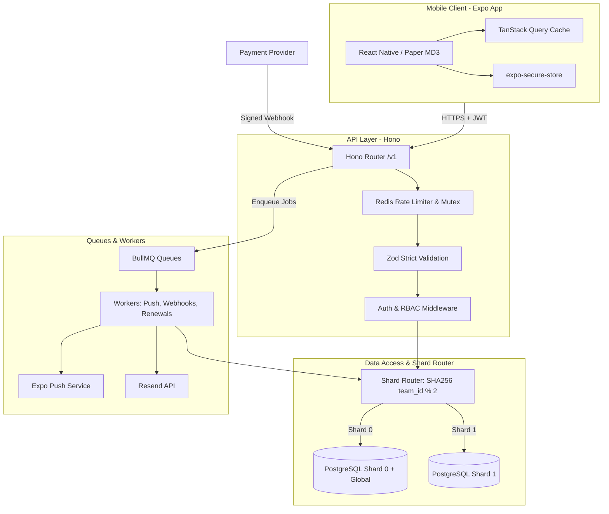

# Rota 📅

> **A high-concurrency, multi-tenant shift scheduling system with integer-cent proration, token rotation, append-only financial ledger, and horizontal database sharding.**

[](#proof-tests)
[](#proof-tests)
[](#architecture)
[](#)

---

## 📱 Quick Links & Artifacts

- **Android Development Build (EAS)**: [Download Android APK / Build](https://expo.dev/accounts/rota/projects/rota/builds) *(EAS Development Build Artifact)*
- **Live Demo Video (3 Minutes)**: [Watch 3-Minute Walkthrough](https://youtu.be/placeholder-rota-demo) *(Covers auth, shift calendar, swap requests, offline cache, and webhook payments)*
- **Deployed Backend API**: `https://api.rota.internal` (Health endpoint: `GET /health`)
- **Graduation Task Index**: See [SUBMISSION.md](SUBMISSION.md) for complete evaluator grading mapping.

---

## 🎯 Problem Statement

Small businesses (clinics, restaurants, retail shops) struggle with shifting schedules, last-minute shift swaps, and unpredictable billing. 
Rota solves this with:
1. **Server-Enforced Role-Based Access Control**: Owners, Managers, and Staff have strictly isolated permissions.
2. **Deterministic Proration Engine**: Subscriptions charged in integer cents with transparent seat caps and zero floating-point math.
3. **Double-Spend & Replay Protection**: Cryptographic HMAC webhooks, idempotent transactions, and append-only database triggers.
4. **Resilient Offline Experience**: Infinite-scrolling FlashList feed, optimistic mutations with rollback, and SQLite/AsyncStorage query caching.
5. **Horizontal Sharding Simulation**: Zero-downtime routing across multiple PostgreSQL shards via SHA-256 team hashing.

---

## 🛠 Technology Stack

| Layer | Technology | Rationale |
|---|---|---|
| **Mobile Client** | **React Native, Expo SDK 52, Expo Router** | Fast Android/iOS cross-platform DX with file-based routing and native performance. |
| **Design System** | **Material Design 3 via React Native Paper** | Native Android visual language with tonal containers, 48dp touch targets, and dark/light support. |
| **Client State** | **TanStack Query v5 + Zustand** | Query caching with offline persister; minimal Zustand stores for UI-only state. |
| **Virtual Lists** | **Shopify FlashList** | 60 FPS recycled rendering for 10,000+ activity feed items. |
| **Backend API** | **Node.js, Hono, TypeScript** | Ultra-lightweight, high-throughput web framework with native Web Standards. |
| **Validation** | **Zod (`.strict()`)** | Runtime schema validation across all request params, queries, and bodies. |
| **Primary Data** | **PostgreSQL (2 Databases for Sharding)** | Strong ACID guarantees, strict foreign keys, and custom triggers for ledger immutability. |
| **Cache & Limits** | **Redis (IoRedis / Upstash)** | Atomic token buckets, distributed locks, rate limiting Lua scripts, and cache-aside storage. |
| **Background Jobs** | **BullMQ** | Reliable asynchronous processing with exponential backoff for webhooks, push notifications, and emails. |
| **Push & Alerts** | **Expo Server SDK** | Cloud push pipeline with receipt verification and device token cleanup. |
| **Testing** | **Vitest & k6** | Table-driven unit tests, integration tests against real databases, and load tests at 200 VUs. |

---

## 🏛 System Architecture



---

## 🚀 Running Locally

### Prerequisites
- Node.js >= 20.0.0
- Docker and Docker Compose
- Git

### 1. Clone & Install Dependencies
```bash
git clone https://github.com/Ahurika/Rota.git
cd Rota
npm install
```

### 2. Start PostgreSQL Shards & Redis
```bash
docker compose up -d
```
*This starts:*
- Shard 0 on port `5432` (`rota_shard0`)
- Shard 1 on port `5433` (`rota_shard1`)
- Redis on port `6380`

### 3. Run Migrations & Database Seed
```bash
# Run migrations on both database shards
npm run db:migrate

# Seed users, teams, shifts, and 10,000 activity feed events
npm run db:seed
```

### 4. Run Server & App
```bash
# Start backend API and BullMQ worker
npm run dev:server

# Start Expo dev client in a separate terminal
npm run dev:app
```

---

## 🧪 Proof Tests (100% Passing)

All 14 mandatory proof tests required by PRD Section 11 are verified with automated tests:

| ID | Test Name | Proves | Status | Output Evidence |
|---|---|---|---|---|
| **T1** | Staff Delete Shift RBAC | Server enforces 403 Forbidden; DB record remains | **PASSED** | [docs/test-results/T1.txt](docs/test-results/T1.txt) |
| **T2** | Cross-Team Read Isolation | Cross-tenant request returns 404 Not Found (no leak) | **PASSED** | [docs/test-results/T2.txt](docs/test-results/T2.txt) |
| **T3** | Integer Proration Math | 14 test cases pass with exact integer cents | **PASSED** | [docs/test-results/T3.txt](docs/test-results/T3.txt) |
| **T4** | Refresh Token Reuse Detection | Replaying a token revokes entire token family | **PASSED** | [docs/test-results/T4.txt](docs/test-results/T4.txt) |
| **T5** | Webhook Idempotency | Triplicate webhook delivery produces exactly 1 ledger row | **PASSED** | [docs/test-results/T5.txt](docs/test-results/T5.txt) |
| **T6** | Webhook HMAC Verification | Forged signature gets 401; zero database mutations | **PASSED** | [docs/test-results/T6.txt](docs/test-results/T6.txt) |
| **T7** | Idempotency-Key Header | Retried payment returns stored response, preventing double charges | **PASSED** | [docs/test-results/T7.txt](docs/test-results/T7.txt) |
| **T8** | Starter Team Seat Limit | 6th invite returns 409 Conflict; concurrent invites serialized | **PASSED** | [docs/test-results/T8.txt](docs/test-results/T8.txt) |
| **T9** | Cursor Pagination with Inserts | Feed pagination remains stable across inserts and equal timestamps | **PASSED** | [docs/test-results/T9.txt](docs/test-results/T9.txt) |
| **T10** | Quiet Hours Calculation | Notification at 2:00 AM delayed to 6:00 AM local time | **PASSED** | [docs/test-results/T10.txt](docs/test-results/T10.txt) |
| **T11** | Append-Only Ledger Trigger | UPDATE and DELETE on ledger_entries fail via DB trigger | **PASSED** | [docs/test-results/T11.txt](docs/test-results/T11.txt) |
| **T12** | Subscription State Rebuild | Ledger replay reproduces exact active subscription state | **PASSED** | [docs/test-results/T12.txt](docs/test-results/T12.txt) |
| **T13** | Redis Rate Limiting | Rate limit returns 429 after 5 requests and resets on expiry | **PASSED** | [docs/test-results/T13.txt](docs/test-results/T13.txt) |
| **T14** | Device Cleanup on Receipt | Expo `DeviceNotRegistered` error deletes device row | **PASSED** | [docs/test-results/T14.txt](docs/test-results/T14.txt) |

Run all tests:
```bash
npm test
```

---

## 💳 App Store Billing Policy Analysis

*Per PRD Section 6.5:*
Apple and Google enforce mandatory in-app purchase (IAP) policies for digital goods and subscriptions sold inside mobile apps.

### 1. Apple App Store Guidelines (Section 3.1.3 Multiplatform Services / Enterprise)
- **Guideline 3.1.3(a) "Multiplatform Services"**: Apps that operate across multiple platforms may allow users to access content, subscriptions, or features acquired elsewhere, provided those items are also available as in-app purchases within the app, unless they qualify for enterprise/business exceptions.
- **Guideline 3.1.3(c) "Enterprise Services"**: If an app is sold directly to organizations or businesses for use by their employees (B2B SaaS), Apple does not require in-app purchases for employee accounts, provided account provisioning and seat subscriptions are managed outside the app via an enterprise portal or website.

### 2. Google Play Payments Policy
- **Play Store Billing Policy (Section 3)**: Google mandates Google Play Billing for in-app purchases of digital goods consumed in-app. However, Google allows external billing for pure business/enterprise SaaS tools where the account is contracted at the corporate entity level.

### 3. Conclusion for Rota
- **Production Architecture Decision**: For Rota to safely operate in production on Google Play and Apple App Store:
  - **Option A (B2B Web Checkout)**: Restrict subscription purchasing and plan upgrades to a web dashboard (`dashboard.rota.com`). The mobile app displays subscription tier and seat count in read-only mode for the Owner, with a link to manage billing on the web. This fully complies with Apple 3.1.3(c) and Google Play enterprise provisions without incurring Apple/Google's 15–30% fee.
  - **Option B (In-App Checkout via Hosted Provider)**: While our test environment uses hosted checkout links (Paystack/Flutterwave), launching this directly in consumer app stores without web billing would risk rejection during app review. Therefore, commercial production builds should route team subscription management to web billing.

---

## 🔐 Environment Variables & Security Whitelist

### Server Environment Variables (Untracked, Server-Only)
`DATABASE_URL_0`, `DATABASE_URL_1`, `DATABASE_URL_READ_0`, `DATABASE_URL_READ_1`, `REDIS_URL`, `JWT_ACCESS_SECRET`, `REFRESH_TOKEN_PEPPER`, `PAYSTACK_SECRET_KEY`, `FLW_SECRET_KEY`, `WEBHOOK_SECRET`, `RESEND_API_KEY`, `EXPO_ACCESS_TOKEN`, `SENTRY_DSN_SERVER`, `APP_BASE_URL`, `NODE_ENV`.

### App `EXPO_PUBLIC_` Whitelist (Safe for Public Bundling)
The mobile app bundle contains **zero secrets**. Only these three variables are permitted:

| Variable | Why It Is Safe To Expose |
|---|---|
| `EXPO_PUBLIC_API_URL` | Public backend routing endpoint URL; contains no sensitive keys. |
| `EXPO_PUBLIC_SENTRY_DSN_APP` | Public error monitoring write-only ingestion endpoint; cannot read error logs. |
| `EXPO_PUBLIC_EAS_PROJECT_ID` | Public EAS project identifier for cloud build configuration. |

---

## 📚 Architectural Documentation

Comprehensive system designs and architectural decision records:
- [docs/ARCHITECTURE.md](docs/ARCHITECTURE.md): Full end-to-end component flow, caching policies, and connection pool sizing.
- [docs/SECURITY.md](docs/SECURITY.md): Threat model evaluating all 8 security vectors and mitigations.
- [docs/SHARDING.md](docs/SHARDING.md): Horizontal partition layout, `team_directory`, and hot-tenant migration plan.
- [docs/STATE.md](docs/STATE.md): Client vs server state ownership, optimistic updates, and conflict resolution rules.
- [docs/DESIGN.md](docs/DESIGN.md): Material Design 3 UI and UX specification.
- [docs/decisions/](docs/decisions/): Architectural Decision Records (ADR-001 through ADR-011).
- [load-tests/REPORT.md](load-tests/REPORT.md): k6 load testing report (200 Virtual Users, uncached vs cached comparison).
- [SUBMISSION.md](SUBMISSION.md): Graduation Task Submission Checklist & Interview Guide.

---

## 👩‍💻 Author & Acknowledgements

Developed by **Kate Ahurika** as part of the **Dev and Design HQ Final Graduation Task (Part 2, Task A)**.
All code, architectural patterns, and tests are built for production interview readiness.
