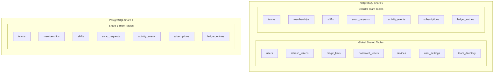

# Rota Sharding Architecture Specification

This document details Rota's multi-database horizontal partitioning architecture, shard routing strategy, cross-shard query patterns, and hot-tenant scaling plan.

---

## 1. Overview and Partitioning Strategy

Rota implements an application-level **sharding simulation across two separate PostgreSQL instances** (`rota_shard0` and `rota_shard1`). 

### 1.1 The Shard Key: `team_id`

- Every team in Rota is a self-contained operational unit (a clinic, restaurant, or retail store).
- Because 95% of application interactions (shifts, roster schedules, swaps, activity feed, billing subscriptions, ledger) occur strictly within the context of a single team, **`team_id`** is the natural partitioning key.
- All intra-team operations execute within a single database shard, guaranteeing complete transactional ACID boundaries without distributed two-phase commits (2PC).

### 1.2 Shard Hash Algorithm

The application router maps each `team_id` (a UUID v4) to a shard index using the first 4 bytes of its cryptographic SHA-256 digest:

```typescript
export function getShardForTeam(teamId: string): number {
  const hash = crypto.createHash('sha256').update(teamId).digest();
  const value = hash.readUInt32BE(0);
  return value % 2; // Returns 0 or 1
}
```

- **Uniform Distribution**: The SHA-256 hash guarantees uniform pseudo-random dispersion across shard 0 and shard 1, preventing systematic skew from sequential keys.
- **Deterministic**: The function is pure and stateless; given any `team_id`, all API instances and background workers resolve the identical shard without inter-node coordination.

---

## 2. Table Placement: Global vs Sharded Tables



### 2.1 Global Tables (Live on Database 0)
Tables that are user-centric rather than team-centric are stored globally on Database 0:
- `users`: User authentication, credentials, email (unique across entire system).
- `refresh_tokens`, `magic_links`, `password_resets`: Session lifecycle tokens.
- `devices`: Expo push notification tokens per device.
- `user_settings`: User quiet hours, timezone, notification toggles, theme.
- `team_directory`: Fast lookup table storing `(user_id, team_id, role, shard)`.

### 2.2 Sharded Tables (Partitioned across Shard 0 and Shard 1)
Data isolated per team lives exclusively on the team's designated shard:
- `teams`
- `memberships`
- `invites`
- `shifts`
- `swap_requests`
- `activity_events`
- `subscriptions`
- `ledger_entries`
- `payment_attempts`
- `webhook_events`

---

## 3. Known Weakness and Mitigation

### Asymmetric Load on Database 0
- **The Problem**: Database 0 hosts all global tables (authentication, sessions, push tokens) in addition to roughly 50% of the team-partitioned data. As a consequence, Database 0 experiences higher CPU and I/O utilization than Shard 1.
- **Mitigation & Future Evolution**:
  1. **Read Replicas**: High-volume read traffic on global tables (e.g., verifying user tokens or reading user settings) is offloaded to replica connections (`DATABASE_URL_READ_0`).
  2. **Dedicated Metadata Cluster**: In high-scale production, global tables would migrate to a dedicated metadata database (`DB_GLOBAL`), leaving Shards 0 through $N$ dedicated exclusively to tenant workloads.

---

## 4. Complex & Cross-Shard Queries

When queries span beyond a single `team_id`, Rota uses specific routing patterns:

### 4.1 "All Teams for a User" (`GET /v1/teams`)
- **The Problem**: A user may belong to multiple teams residing on different shards. Scanning every shard would require a high-latency scatter-gather query.
- **The Solution: `team_directory`**:
  - Whenever a team is created or a membership is added/removed on any shard, a global entry is written to `team_directory` on Database 0: `(user_id, team_id, role, shard)`.
  - When the user lists their teams, the API issues a single index scan on `team_directory WHERE user_id = $1` on Database 0, eliminating cross-shard queries.

### 4.2 "Find All Past-Due Subscriptions" (Renewal Worker)
- **The Problem**: The subscription renewal worker runs periodically to check for failed payments, grace period expirations, and restricted mode transitions. Subscriptions live on both shards.
- **The Solution: Scatter-Gather Fanout**:
  - The renewal worker issues concurrent queries to Shard 0 and Shard 1:
    ```typescript
    const [pastDue0, pastDue1] = await Promise.all([
      db.forShard(0).subscription.findMany({ where: { status: 'past_due' } }),
      db.forShard(1).subscription.findMany({ where: { status: 'past_due' } }),
    ]);
    const allPastDue = [...pastDue0, ...pastDue1];
    ```
  - The results are aggregated in-memory and processed as individual background jobs in BullMQ.

### 4.3 Tenant Isolation Verification
- If an API request specifies a `team_id`, the router routes exclusively to `getShardForTeam(teamId)`. 
- If a user from Team A (on Shard 0) queries Team B (on Shard 1), the membership check on Shard 1 yields no row, returning `HTTP 404 Not Found`.

---

## 5. Hot Tenant & Enterprise Scaling Plan

In multi-tenant SaaS, the 99th percentile team (e.g., an enterprise hospital network with 10,000 shifts) can cause "noisy neighbor" contention for smaller teams on the same shard.

### 5.1 Hot Tenant Override Table (`team_shard_overrides`)
Before executing the SHA-256 hash modulo calculation, the shard router checks an in-memory or Redis-cached table:

```typescript
export async function resolveShard(teamId: string): Promise<number> {
  // 1. Check hot tenant override (cached in Redis with 1 hour TTL)
  const override = await redis.get(`shard_override:${teamId}`);
  if (override !== null) {
    return parseInt(override, 10);
  }

  // 2. Fallback to deterministic SHA-256 hash modulo
  return getShardForTeam(teamId);
}
```

### 5.2 Migration Procedure for an Enterprise Tenant
1. **Provision Dedicated Shard**: Spin up Shard 2 (dedicated to Enterprise Tenant $X$).
2. **Read-Only Lock**: Temporarily place Tenant $X$ in maintenance mode (read-only) for ~60 seconds.
3. **Data Transfer**: Dump and restore Tenant $X$'s rows (`WHERE team_id = X`) from Shard 0 to Shard 2 using `pg_dump` or logical replication.
4. **Update Routing**: Insert `(team_id: X, shard: 2)` into `team_shard_overrides` and invalidate Redis key `shard_override:X`.
5. **Resume Traffic**: Remove maintenance lock. All subsequent traffic for Tenant $X$ routes seamlessly to Shard 2. Clean up old rows from Shard 0.
